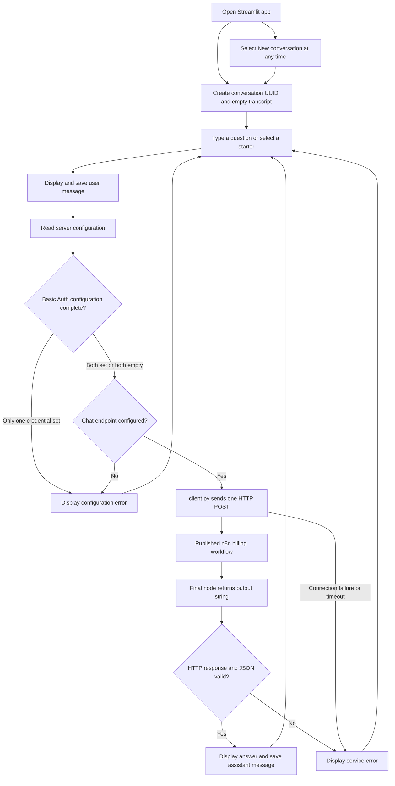

# CloudDesk billing chat flow

The app displays a billing support chat in Streamlit (branded KRMB Desk in the
interface). Python sends each question to the published n8n workflow and displays
the returned answer. The workflow runs outside this repository; retrieval,
embeddings, model calls, and escalation logic are not implemented by this UI.

## Request and response diagram



The n8n box represents an external service boundary, not a diagram of its
internal nodes. The required final response is described below.

## What happens at each step

1. **Start the app.** `app.py` loads environment settings, the theme and artwork,
   and creates a UUID and message list in Streamlit session state.
2. **Submit a question.** Typed input and the invoice, payment, and subscription
   starters use the same request path. The user message is added to the transcript.
3. **Read configuration.** The server reads `N8N_CHAT_URL` and the optional
   `N8N_BASIC_USER` / `N8N_BASIC_PASSWORD` pair. A partially configured auth pair
   or missing URL produces an error without sending a request.
4. **Call n8n.** `client.py` sends one POST to the exact configured URL, with
   optional HTTP Basic Auth. Connect timeout is 10 seconds; read timeout is
   90 seconds. Redirects and automatic retries are disabled.
5. **Validate the reply.** The client requires a successful HTTP status and JSON
   containing a non-empty `output` string. A single-item array containing that
   object is also accepted.
6. **Show the result.** A valid answer is rendered as Markdown and stored in the
   transcript. Failures are shown as errors; they are not saved as assistant
   messages. A failed request does not confirm that a review case was created.
7. **Reset when needed.** New conversation clears the displayed transcript and
   creates a new UUID. It does not cancel an external workflow or delete its data.

## API contract

Example request body (illustrative values only):

```json
{
  "action": "sendMessage",
  "sessionId": "conversation-uuid",
  "chatInput": "Where can I download my invoices?"
}
```

Expected response:

```json
{
  "output": "You can download invoices from your billing settings."
}
```

Configure the n8n Chat Trigger for **Embedded Chat** and **When Last Node
Finishes**, and publish the workflow. The final answering node must return
`output` as a String, for example using
`{{ $json.answer ?? $json.customer_message }}`.

A response containing `executionStarted: true` is an execution acknowledgement,
not an answer. The app reports this response-mode mismatch instead of displaying
it as a successful reply. Authentication failures, other HTTP errors, malformed
JSON, missing output, connection errors, and timeouts also produce errors.

## Conversation state and configuration

The UUID stays the same until New conversation is selected. Only the current
question and UUID are sent to n8n; the displayed transcript is not included in
the request. The interface therefore describes each question as being answered
independently. Source citation IDs in answers are displayed as returned.

Local configuration lives in `.env`, which is excluded from Git. Deployment must
provide the same environment settings on the server. Keep credentials out of
source files and diagrams; `.env.example` lists the required setting names.

## Files to follow

| File | Responsibility |
| --- | --- |
| [`app.py`](../app.py) | Interface, configuration, session state, and message display |
| [`client.py`](../client.py) | HTTP request, response validation, and service errors |
| [`.env.example`](../.env.example) | Configuration template without real credentials |
| [`.streamlit/config.toml`](../.streamlit/config.toml) | Streamlit theme |
| [`assets/`](../assets/) | Chat styling and billing artwork |
| [`tests/`](../tests/) | UI and client tests using mocked service responses |
