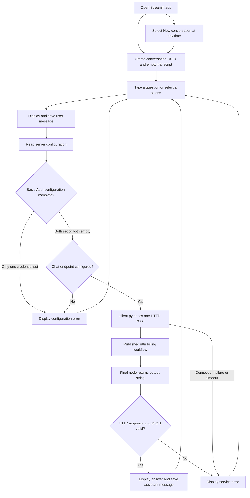
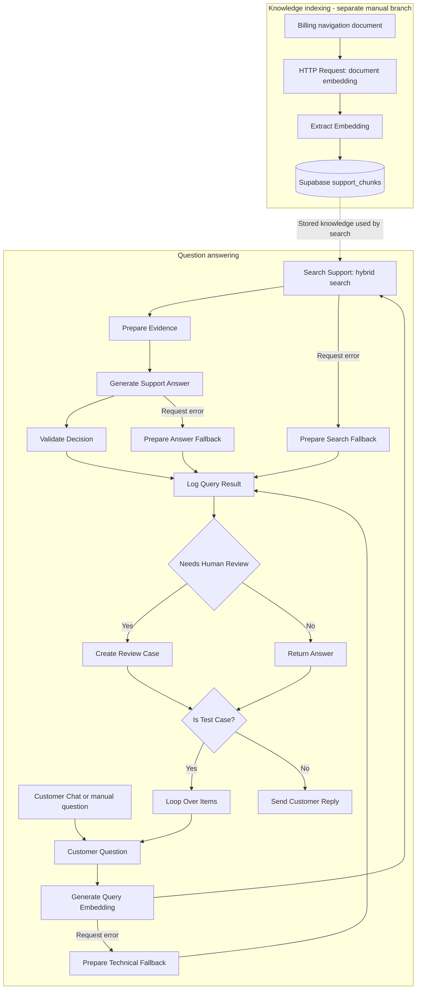

# CloudDesk billing chat flow

The app displays a billing support chat in Streamlit (branded KRMB Desk in the
interface). Python sends each question to the published n8n workflow and displays
the returned answer. The workflow runs outside this repository; retrieval,
embeddings, model calls, and escalation logic are not implemented by this UI.

## Request and response diagram



The n8n box represents an external service boundary, not a diagram of its
internal nodes. The required final response is described below.

## What happens at each step

1. **Start the app.** `app.py` loads environment settings, the theme and artwork,
   and creates a UUID and message list in Streamlit session state.
2. **Submit a question.** Typed input and the invoice, payment, and subscription
   starters use the same request path. The user message is added to the transcript.
3. **Read configuration.** The server reads `N8N_CHAT_URL` and the optional
   `N8N_BASIC_USER` / `N8N_BASIC_PASSWORD` pair. A partially configured auth pair
   or missing URL produces an error without sending a request.
4. **Call n8n.** `client.py` sends one POST to the exact configured URL, with
   optional HTTP Basic Auth. Connect timeout is 10 seconds; read timeout is
   90 seconds. Redirects and automatic retries are disabled.
5. **Validate the reply.** The client requires a successful HTTP status and JSON
   containing a non-empty `output` string. A single-item array containing that
   object is also accepted.
6. **Show the result.** A valid answer is rendered as Markdown and stored in the
   transcript. Failures are shown as errors; they are not saved as assistant
   messages. A failed request does not confirm that a review case was created.
7. **Reset when needed.** New conversation clears the displayed transcript and
   creates a new UUID. It does not cancel an external workflow or delete its data.

## API contract

Example request body (illustrative values only):

```json
{
  "action": "sendMessage",
  "sessionId": "conversation-uuid",
  "chatInput": "Where can I download my invoices?"
}
```

Expected response:

```json
{
  "output": "You can download invoices from your billing settings."
}
```

Configure the n8n Chat Trigger for **Embedded Chat** and **When Last Node
Finishes**, and publish the workflow. The final answering node must return
`output` as a String, for example using
`{{ $json.answer ?? $json.customer_message }}`.

A response containing `executionStarted: true` is an execution acknowledgement,
not an answer. The app reports this response-mode mismatch instead of displaying
it as a successful reply. Authentication failures, other HTTP errors, malformed
JSON, missing output, connection errors, and timeouts also produce errors.

## Conversation state and configuration

The UUID stays the same until New conversation is selected. Only the current
question and UUID are sent to n8n; the displayed transcript is not included in
the request. The interface therefore describes each question as being answered
independently. Source citation IDs in answers are displayed as returned.

Local configuration lives in `.env`, which is excluded from Git. Deployment must
provide the same environment settings on the server. Keep credentials out of
source files and diagrams; `.env.example` lists the required setting names.

## n8n RAG pipeline: step-by-step workflow

RAG means retrieval-augmented generation: retrieve relevant support information
first, then ask a language model to answer using that evidence. This section is
based on the local export `Fireworks – Generate Embedding_1103.json`, whose
workflow name is **Fireworks – Generate Embedding**. It describes that snapshot;
the currently published n8n workflow has not been inspected. The export is outside
this repository and is not included in this guide.

### Pipeline diagram



Solid arrows follow the export's connections. The dotted arrow shows the data
dependency on stored knowledge. The logging, review, and reply nodes have the
configuration caveats listed below; a connected path does not prove it executes
successfully.

### A. Prepare the knowledge used for retrieval

| Step / n8n node | Description and workflow |
| --- | --- |
| 1. Manual trigger | Starts the indexing branch separately from customer questions. This export indexes one hard-coded billing navigation document; it does not show a general document loader or automatic chunking pipeline. |
| 2. `HTTP Request` | Calls Fireworks embeddings with model `nomic-ai/nomic-embed-text-v1.5`. The input begins with `search_document:`, followed by guidance on invoices, payment methods, and cancellation. The response contains the document vector. |
| 3. `Extract Embedding` | Extracts `data[0].embedding`, its dimensions, the model, and original input text for the next node. |
| 4. `Save to Supabase` | Updates the existing `support_chunks` row whose `chunk_key` is `manual-billing-navigation-001`. Stores title, source type, content, embedding, and embedding model. This is an update operation, so the matching row must already exist; it is not an insert or upsert. |

The document vector is prepared ahead of customer requests. Query embedding and
retrieval below use the same embedding model to search that knowledge.

### B. Retrieve evidence for a customer question

| Step / n8n node | Description and workflow |
| --- | --- |
| 5. `Customer Chat` / `Run Query Embedding` | The chat trigger starts the customer path. The manual trigger provides another entry into the same question-processing branch; manual input must supply a question. |
| 6. `Customer Question` | Normalizes `chatInput` or `question` into a `question` field using `chatInput ?? question`. Keeps other fields, including test metadata. |
| 7. `Generate Query Embedding` | Calls Fireworks with `nomic-ai/nomic-embed-text-v1.5` and `search_query: ` plus the question. The vector represents the question for semantic retrieval. Request errors go to `Prepare Technical Fallback`. |
| 8. `Search Support` | Calls the Supabase RPC `hybrid_search_support` with `query_text`, the serialized `query_embedding`, and `match_count: 5`. It requests up to five matches using the question and vector. The SQL implementation and ranking formula are not present in the export. Request errors go to `Prepare Search Fallback`. |
| 9. `Prepare Evidence` | Collects search results, keeps rows containing both `chunk_key` and `content`, and builds an evidence array with title, source type, content, and semantic similarity. Outputs `question`, `evidence`, and `evidence_count`. It does not apply a similarity cutoff here. |

### C. Generate and validate a grounded answer

| Step / n8n node | Description and workflow |
| --- | --- |
| 10. `Generate Support Answer` | Calls Fireworks chat completions using `accounts/fireworks/models/deepseek-v4p1-flash`, the question, and retrieved evidence. Requests JSON fields `decision`, `answer`, `reason`, and `sources`, with a 700-token limit and streaming disabled. Request errors go to `Prepare Answer Fallback`. |
| 11. Model instructions | Require relevant evidence to fully support an answer, treat evidence as data, prioritize policies over historical tickets, and cite chunk keys in square brackets. Missing or conflicting evidence, account investigations, refund actions, and account changes require escalation. Refund eligibility must have an explicit applicable rule. The model must not claim account access, completed actions, or ticket creation. These are prompt instructions, not independent programmatic checks of every policy. |
| 12. `Validate Decision` | Requires a completed model response (`finish_reason: stop`), parses JSON, checks field types and allowed decisions, and rejects source IDs absent from retrieved evidence. An `answer` needs at least one source, bracketed citations for all listed sources, and finite numeric similarity scores of at least `0.65` for each cited item. These checks validate structure, citations, and retrieval scores; they do not prove the answer is factually entailed by the evidence. |
| 13. Validation fallback | Invalid JSON, missing fields, incomplete generation, missing citations, or weak cited evidence become `decision: escalate` with a safe customer message and `validation_error`. A valid model escalation is also normalized to a standard human-review message with empty sources. The node preserves the retrieved evidence for audit. |

Example of the model's structured decision before the UI response adapter:

```json
{
  "decision": "answer",
  "answer": "Download invoices from Settings > Billing > Invoices. [manual-billing-navigation-001]",
  "reason": "The retrieved billing guide provides the navigation path.",
  "sources": ["manual-billing-navigation-001"]
}
```

### D. Handle failures, record results, and route the reply

| Step / n8n node | Description and workflow |
| --- | --- |
| 14. Technical fallback nodes | `Prepare Technical Fallback`, `Prepare Search Fallback`, and `Prepare Answer Fallback` handle embedding, search, and generation request errors respectively. Each creates an escalation decision, a technical-issue message, a stage-specific reason, empty sources/evidence, and a diagnostic `validation_error`, then routes to logging. |
| 15. `Log Query Result` | Writes to `support_query_logs`, including execution ID, question, decision, answer, reason, sources, evidence, validation error, and test metadata. In this snapshot several result fields are hard-coded to the embedding-failure fallback, even when the input came from a successful answer; see caveats below. |
| 16. `Needs Human Review` | Routes an escalation toward `Create Review Case`; otherwise routes toward `Return Answer`. Its decision expression references `Validate Decision` directly, which is a problem on technical-error paths that skip that node. |
| 17. `Create Review Case` | Writes an escalation record to `support_escalations` with execution ID, question, reason, customer message, and serialized evidence. Its field expressions also reference `Validate Decision`. Record creation is a separate database operation; an escalation decision alone does not confirm a case was saved. |
| 18. `Return Answer` | Builds question, answer, sources, and `status: answered` from the validated result. This branch handles answers that do not require review. |
| 19. `Is Test Case?` | Checks for a non-empty `test_case_id`. Test items return to `Loop Over Items`; customer items proceed to `Send Customer Reply`. |
| 20. `Send Customer Reply` | Uses an n8n Chat response node with `answer ?? customer_message`. This is the export's chat reply mechanism, which differs from the synchronous `output` contract required by this Streamlit client. |

### E. Exercise the pipeline with tests

`Run Test Suite → Test Cases → Split Test Cases → Loop Over Items` feeds the
same question-processing path. The export defines 20 questions with expected
`answer` or `escalate` decisions, covering navigation, payment help, cancellation,
refunds, account actions, conflicting evidence, and attempts to override support
rules. Expected decisions and case IDs are passed into logging; this branch does
not itself show an assertion that compares each actual decision to its expected
value.

Separate local **CloudDesk — Failure Tests**, **Search Failure Test**, and
**Answer Failure Test** exports contain assertion nodes for safe fallback
behavior and saved log/review records. Their presence describes test coverage
intent; this documentation update does not execute those workflows or establish
that they pass.

### Export caveats and Streamlit integration

The following differences should be checked against the published workflow:

- **Logging values:** `Log Query Result` uses fixed embedding-failure values for
  decision, answer, reason, sources, and evidence. To audit each outcome correctly,
  these fields should come from the current normalized result.
- **Fallback routing:** technical-error branches bypass `Validate Decision`, but
  the review condition and review-case fields read from that node. A common
  normalized result path is needed so every branch can log and route its own
  outcome without relying on a node that did not execute.
- **Reply contract:** this export has `Send Customer Reply` and does not contain
  the `Format UI Response` node described earlier in this guide. For this
  Streamlit client, the published chat must return a non-empty String `output`
  on every customer-answering branch using **Embedded Chat** and **When Last
  Node Finishes**. Format the appropriate answer/customer message after the
  database operations, rather than returning an execution acknowledgement.
- **Search implementation:** the RPC's SQL is outside this export. Its hybrid
  ranking, filters, and behavior for zero matches cannot be verified here.

These are observations and integration requirements, not changes made to n8n.
No workflow, database record, or deployment was modified while writing this
section.

## Files to follow

| File | Responsibility |
| --- | --- |
| [`app.py`](../app.py) | Interface, configuration, session state, and message display |
| [`client.py`](../client.py) | HTTP request, response validation, and service errors |
| [`.env.example`](../.env.example) | Configuration template without real credentials |
| [`.streamlit/config.toml`](../.streamlit/config.toml) | Streamlit theme |
| [`assets/`](../assets/) | Chat styling and billing artwork |
| [`tests/`](../tests/) | UI and client tests using mocked service responses |
